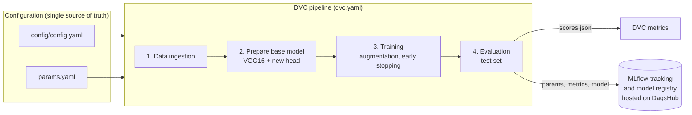
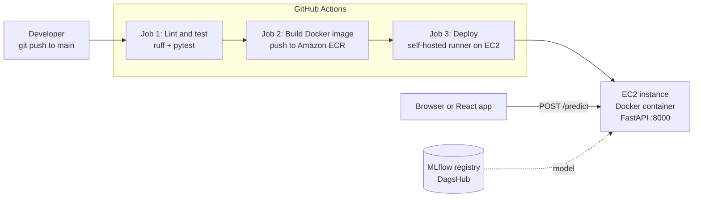

# 🫁 Chest Cancer Classification: End-to-End MLOps Project

[](https://github.com/AhsanShahzad5/Chest-Cancer-Classification-Deep-Learning-Project/actions/workflows/main.yaml)


A deep-learning image classifier that labels chest CT scans as **Adenocarcinoma cancer** or **Normal**, built as a complete MLOps system rather than a notebook: a reproducible training pipeline, experiment tracking, a model registry, a REST API, a container image, automated tests, and a CI/CD pipeline that ships it to AWS.

> ⚠️ **For learning and portfolio purposes only. This is not a medical device and must not be used for diagnosis.**

---

## 📑 Table of contents

1. [Architecture](#-architecture)
2. [MLOps practices used](#-mlops-practices-used)
3. [The ML pipeline](#-the-ml-pipeline)
4. [Model and results](#-model-and-results)
5. [Project structure](#-project-structure)
6. [API reference](#-api-reference)
7. [Getting started](#-getting-started)
8. [CI/CD and deployment](#-cicd-and-deployment)
9. [Configuration](#-configuration)
10. [Status](#-status)

---

## 🏗 Architecture

The project is split into two halves that meet at the **model**: a *training side* that produces and versions models, and a *serving side* that packages and deploys them.

### Training side: reproducible, tracked, versioned



### Serving side: tested, containerised, auto-deployed



### Design pattern: configuration-driven modular pipeline

Every stage follows the same layered recipe, so adding a stage is mechanical and nothing is hard-coded:

```
config.yaml / params.yaml  →  entity (typed dataclass)  →  ConfigurationManager
                           →  component (the logic)     →  pipeline stage (the entry point)
```

* **Entities** are immutable, typed dataclasses, so a wrong config fails early and loudly.
* **ConfigurationManager** is the only code that reads YAML. It also creates the artifact folders.
* **Components** contain only the logic (download, build model, train, evaluate) and know nothing about files or YAML.
* **Pipeline stages** wire a component to its config and can be run alone or through DVC.

---

## ✅ MLOps practices used

| Practice | What this project does | Where |
|---|---|---|
| **Reproducible pipelines** | The workflow is a DVC DAG. `dvc repro` re-runs only the stages whose code, data, or params changed | `dvc.yaml`, `dvc.lock` |
| **Config and code separation** | Paths and URLs in `config.yaml`, hyper-parameters in `params.yaml`, secrets in `.env` | `config/`, `params.yaml` |
| **Parameter-aware caching** | Each DVC stage declares the exact params it depends on, so changing `EPOCHS` retrains but doesn't re-download data | `dvc.yaml` |
| **Data and model versioning** | A DVC remote on DagsHub stores the dataset and every stage output. `git clone` + `dvc pull` restores the exact data and model for any commit, on any machine | `.dvc/config`, `dvc.lock` |
| **Experiment tracking** | Every pipeline run logs its params and metrics to MLflow, so runs can be compared | `model_evaluation_mlflow.py` |
| **Model registry** | Each run registers a new `VGG16Model` version. The `champion` alias marks the one that is served | MLflow on DagsHub |
| **Automated retraining** | A manual or weekly workflow runs the DVC pipeline in CI and registers the result as a candidate version. A human promotes it | `.github/workflows/retrain.yaml` |
| **Metrics under version control** | `scores.json` is tracked as a DVC metric, so `dvc metrics show` and `dvc metrics diff` work | `scores.json` |
| **Modular, typed code** | Layered architecture, typed config entities, custom logger | `src/cnnClassifier/` |
| **Automated testing** | API, validation, logging, and prediction tests run against a fake model, so CI needs no model file or network | `tests/` |
| **Linting and pre-commit hooks** | `ruff` with a project-level rule set, so local and CI results match. Pre-commit runs it on every commit, along with whitespace, YAML, secret-key, and large-file checks | `pyproject.toml`, `.pre-commit-config.yaml` |
| **Input validation** | Uploads are checked by content, not by the client's header: real JPEG or PNG, at most 5 MB and 16 megapixels. Bad input gets a clear 4xx, never a 500 | `utils/image_validation.py` |
| **Rate limiting** | `/predict` is capped per client IP (default 10 per minute) and answers `429` with `Retry-After`, so one client cannot starve the others | `app.py` |
| **Typed API contract** | Pydantic response models validate every reply and publish the exact shape in `/docs` and `/openapi.json` | `entity/schemas.py` |
| **Liveness and readiness probes** | `/health` says the process is alive. `/ready` returns 200 only when a model is loaded, and is what the deploy waits on | `app.py` |
| **Structured logging** | Every log line is one JSON object. Each request gets an ID (returned as `X-Request-ID`) and one access line with status and latency | `src/cnnClassifier/__init__.py`, `app.py` |
| **Containerisation** | Slim, layer-cached Docker image. Production dependencies only, with no secrets baked in | `Dockerfile`, `.dockerignore` |
| **Dependency locking** | `uv.lock` pins every package. CI installs with `--frozen` | `pyproject.toml`, `uv.lock` |
| **CI/CD** | Every push to `main` is linted, tested, built, pushed to ECR, and deployed to EC2 | `.github/workflows/main.yaml` |
| **Immutable image tags** | Images are tagged with the commit SHA, so every deployment maps to an exact commit and rollback is a re-deploy | workflow |
| **Safe deployment** | The old container is replaced, then `/ready` must answer 200 (model loaded) or the job fails and prints the container logs | workflow |
| **Least privilege and secrets hygiene** | CI uses an ECR-only IAM user. Secrets live in GitHub Secrets and are passed to the container as environment variables | workflow |
| **Separation of training and serving** | The API never trains. Retraining is triggered by pipeline runs, not by user requests | `app.py`, `utils/training.py` |
| **Model registry as the serving source** | The API loads `models:/VGG16Model@champion` at startup, so the image holds no model and a model change needs no code change | `utils/model_loader.py` |

---

## 🔬 The ML pipeline

Run end to end with `uv run dvc repro`. Each stage is also runnable on its own.

| # | Stage | What it does | Output |
|---|---|---|---|
| 1 | **Data ingestion** | Downloads the CT scan dataset from Google Drive with `gdown` and unzips it | `artifacts/data_ingestion/` |
| 2 | **Prepare base model** | Loads VGG16 pre-trained on ImageNet **without** its classifier head, freezes it, and adds a `Flatten` + `Dense(2, softmax)` head | `artifacts/prepare_base_model/` |
| 3 | **Training** | Trains the new head with augmentation, an 80/20 train/validation split, `EarlyStopping`, and `ReduceLROnPlateau` | `artifacts/training/model.h5` |
| 4 | **Evaluation** | Scores the model on the held-out test set, writes `scores.json`, and logs params, metrics, and the model to MLflow as a new registry version | `scores.json` |

```bash
uv run dvc dag       # visualise the pipeline
uv run dvc repro     # run only what changed
uv run dvc metrics show
```

---

## 🧠 Model and results

* **Approach:** transfer learning (feature extraction) with **VGG16**, ImageNet weights, a frozen base, and a new 2-class softmax head.
* **Input:** 224 × 224 RGB, preprocessed with VGG16's `preprocess_input` (the same function at training, evaluation, and prediction time).
* **Augmentation:** rotation, shifts, shear, zoom, and horizontal flip.
* **Hyper-parameters** (in `params.yaml`): 20 epochs, batch size 16, learning rate 1e-4.
* **Dataset:** CT scan images in two classes. 369 training images (218 adenocarcinoma, 151 normal) and 174 test images (120 adenocarcinoma, 54 normal).

**Experiment tracking.** Four runs are registered in the MLflow model registry as `VGG16Model`, and the latest DVC-tracked run in `scores.json` scored **87.9% accuracy** (loss 0.85) on the test set. Re-scoring registry versions on the same 174 test images through the serving code gave: v2 81.0%, v3 86.8%, **v4 88.5%** (the best, so it is the `champion`). The accuracy logged by earlier runs was measured on different evaluation sets and is not comparable, a good reminder that models should only be compared on one fixed test set.

> The test set is small and imbalanced (about 69% adenocarcinoma), so treat accuracy figures with caution. They show the pipeline works, not clinical performance.

---

## 📂 Project structure

```
.
├── .github/workflows/
│   ├── main.yaml                 # CI/CD: test, build, push to ECR, deploy to EC2
│   └── retrain.yaml              # retrain in CI and register a new model version
├── .pre-commit-config.yaml       # checks that run on every commit
├── config/config.yaml            # paths and URLs
├── params.yaml                   # hyper-parameters
├── dvc.yaml / dvc.lock           # pipeline definition and locked state
├── scores.json                   # DVC-tracked evaluation metrics
├── src/cnnClassifier/
│   ├── components/               # logic: ingestion, base model, trainer, evaluation
│   ├── config/                   # ConfigurationManager (reads YAML)
│   ├── entity/                   # typed config dataclasses + API response models
│   ├── constants/                # shared constants
│   ├── pipeline/                 # stage entry points + prediction pipeline
│   └── utils/                    # YAML/JSON helpers, model loader, upload validation, training helpers
├── app.py                        # FastAPI application
├── templates/index.html          # simple upload page
├── tests/                        # pytest suite (uses a fake model)
├── research/                     # exploratory notebooks, one per stage
├── Dockerfile / .dockerignore
├── pyproject.toml / uv.lock      # dependencies, ruff + pytest config
└── main.py                       # run all stages sequentially without DVC
```

---

## 🌐 API reference

Served by FastAPI on port **8000**. Interactive docs are at `/docs`.

| Method | Route | Description |
|---|---|---|
| `GET` | `/` | Upload page |
| `GET` | `/health` | **Liveness.** Always 200 while the process is up. Also reports `model_loaded`, `model_source`, and `model_version` |
| `GET` | `/ready` | **Readiness.** 200 when a model is loaded, otherwise 503. The deploy job waits on this |
| `POST` | `/predict` | Classify an uploaded image (`multipart/form-data`, field `file`, JPEG or PNG). Limited to 10 requests per minute per IP |

```bash
curl -F "file=@scan.png;type=image/png" http://localhost:8000/predict
```

```json
{
  "prediction": "Adenocarcinoma Cancer",
  "confidence": 0.9997,
  "model_version": "4"
}
```

`prediction` is `"Normal"` or `"Adenocarcinoma Cancer"`. `confidence` is the model's own score for that class (0 to 1), not a guarantee that it is right. `model_version` is the registry version that answered.

| Status | Meaning |
|---|---|
| `400` | The upload is empty, not a valid image, or not JPEG or PNG. The `Content-Type` header is ignored, so the bytes themselves are checked |
| `413` | The file is larger than 5 MB |
| `422` | The image has more than 16 megapixels |
| `429` | Rate limit reached. Retry after the number of seconds in the `Retry-After` header |
| `503` | No model is loaded |

Every response carries an `X-Request-ID` header. Send your own (letters, digits, `-`, `_`) to trace a request through the logs, or let the server generate one. Logs are JSON, one line per event:

```json
{"time": "2026-10-26T14:06:07.713+00:00", "level": "INFO", "module": "app", "message": "request", "request_id": "demo-123", "method": "POST", "path": "/predict", "status": 200, "latency_ms": 678.0}
```

**Model loading.** The model is downloaded from the MLflow registry **once, at server startup** (a FastAPI lifespan hook) and kept in memory, so requests never reload it. If it can't be loaded, the server refuses to start, so a broken deploy fails its health check instead of looking healthy. Promoting a new model means moving the `champion` alias in MLflow and restarting the container, with no code change or image rebuild.

From a React (or any JS) client:

```js
const form = new FormData();
form.append("file", file);
const res = await fetch("http://<server>:8000/predict", { method: "POST", body: form });
const { prediction, confidence, model_version } = await res.json();
```

---

## 🚀 Getting started

**Prerequisites:** Python 3.11, [uv](https://docs.astral.sh/uv/), Docker (optional).

```bash
# 1. clone and install (dev tools included)
git clone https://github.com/AhsanShahzad5/Chest-Cancer-Classification-Deep-Learning-Project.git
cd Chest-Cancer-Classification-Deep-Learning-Project
uv sync

# 2. create .env (see Configuration below)

# 3. (optional) fetch the dataset and earlier results from the DVC remote
#    needs DagsHub credentials in .dvc/config.local, see Configuration below
uv run dvc pull

# 4. train: runs the DVC stages that changed (all of them on a fresh clone)
uv run dvc repro

# 5. start the API → http://localhost:8000
#    it downloads the `champion` model from the MLflow registry at startup
uv run python app.py
```

**Serving options.** The API picks its model from environment variables (all optional):

| Variable | Default | Meaning |
|---|---|---|
| `MODEL_SOURCE` | `mlflow` | `mlflow` loads from the registry. `local` reads a `.h5` file, useful offline |
| `MODEL_URI` | `models:/VGG16Model@champion` | Which registry model to serve. Use a version (`models:/VGG16Model/2`) to pin one |
| `LOCAL_MODEL_PATH` | `model/model.h5` | File used when `MODEL_SOURCE=local` |
| `RATE_LIMIT` | `10/minute` | Requests per client IP allowed on `/predict`, e.g. `30/minute` |

```bash
# offline: serve the model you just trained, no MLflow needed
mkdir model && cp artifacts/training/model.h5 model/model.h5
MODEL_SOURCE=local uv run python app.py
```

**Quality checks (the same ones CI runs):**

```bash
uv run ruff check .
uv run pytest -q
```

**Pre-commit hooks.** Install once per clone, and the checks then run on every `git commit`:

```bash
uv run pre-commit install
uv run pre-commit run --all-files   # optional: run them on every file now
```

**Docker:**

```bash
docker build -t chest-cancer-app .
docker run --rm -p 8000:8000 --env-file .env chest-cancer-app
```

---

## 🔄 CI/CD and deployment

Defined in [`.github/workflows/main.yaml`](.github/workflows/main.yaml). It runs on every push to `main` (docs-only changes are skipped) and can be started by hand.

| Job | Runs on | Steps |
|---|---|---|
| **1. Lint and test** | GitHub-hosted runner | Install dependencies from the lockfile → `ruff check` → `pytest` |
| **2. Build and push** | GitHub-hosted runner | Build the Docker image → tag with the commit SHA and `latest` → push to **Amazon ECR** |
| **3. Deploy** | **Self-hosted runner on the EC2 server** | Pull the new image → replace the running container → poll `/ready` → fail with logs if the model never loads → prune old images |

Each job `needs` the previous one, so a failing test or build never reaches the server. Deploys are serialised with a concurrency group, so two never overlap.

**Why a self-hosted runner?** The deploy step has to run `docker run` on the EC2 machine itself. Installing GitHub's runner there makes the server pull jobs from GitHub over outbound HTTPS, so no SSH keys are stored and no extra inbound port is opened.

### Automated retraining

[`.github/workflows/retrain.yaml`](.github/workflows/retrain.yaml) closes the loop from "something changed" to "new candidate model". It runs when started by hand (with an optional *force retrain* switch) and every Monday at 03:00 UTC.

1. Pulls data and earlier results from the DVC remote.
2. Runs `dvc repro`, which re-runs only the stages whose code, data, or params changed. If nothing changed it finishes in about a minute.
3. If the pipeline ran, the evaluation stage registers a **new `VGG16Model` version** in MLflow.
4. Pushes the new outputs to the DVC remote and shows the metrics in the run summary.

It never touches the live app. A new version only starts serving when someone compares it with the current one in MLflow, moves the `champion` alias to it, and restarts the container.

**Required GitHub configuration**

| Type | Name |
|---|---|
| Secret | `AWS_ACCESS_KEY_ID`, `AWS_SECRET_ACCESS_KEY` |
| Secret | `MLFLOW_TRACKING_URI`, `MLFLOW_TRACKING_USERNAME`, `MLFLOW_TRACKING_PASSWORD` |
| Variable | `AWS_REGION`, `ECR_REPOSITORY` |

**AWS resources:** one ECR repository, one EC2 instance (Ubuntu, x86, Docker installed, port 8000 open), and one IAM user limited to ECR access.

---

## ⚙️ Configuration

| File | Purpose | Committed? |
|---|---|---|
| `config/config.yaml` | Paths and the dataset URL | ✅ |
| `params.yaml` | Hyper-parameters (image size, epochs, batch size, learning rate, augmentation) | ✅ |
| `.dvc/config` | URL of the DVC remote on DagsHub | ✅ |
| `.env` | MLflow credentials (needed to load the model) | ❌ gitignored |
| `.dvc/config.local` | DVC remote credentials | ❌ gitignored |

`.env` format. No spaces around `=`:

```env
MLFLOW_TRACKING_URI=https://dagshub.com/<user>/<repo>.mlflow
MLFLOW_TRACKING_USERNAME=<dagshub-username>
MLFLOW_TRACKING_PASSWORD=<dagshub-access-token>
```

To let DVC reach the remote (the same DagsHub username and token work):

```bash
uv run dvc remote modify --local origin auth basic
uv run dvc remote modify --local origin user <dagshub-username>
uv run dvc remote modify --local origin password <dagshub-access-token>
```

---

## 🗺 Status

**Implemented:** config-driven pipeline · DVC pipeline with metrics · MLflow tracking and registry on DagsHub · DVC remote on DagsHub · automated retraining workflow · model served from the MLflow registry · FastAPI service and upload page with input validation, rate limiting, typed responses, readiness probe, and JSON logging · Docker image · pytest suite · ruff linting and pre-commit hooks · GitHub Actions workflow for build, push, and deploy.
