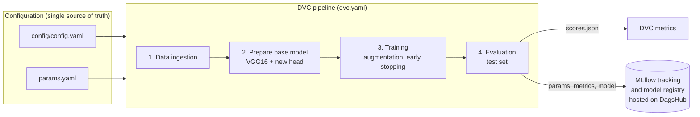
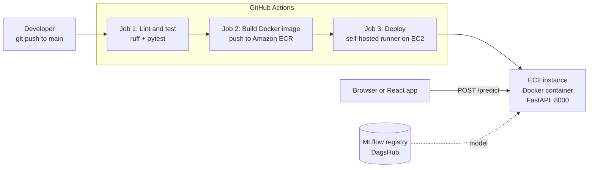

# 🫁 Chest Cancer Classification: End-to-End MLOps Project

[](https://github.com/AhsanShahzad5/Chest-Cancer-Classification-Deep-Learning-Project/actions/workflows/main.yaml)


A deep-learning image classifier that labels chest CT scans as **Adenocarcinoma cancer** or **Normal**, built as a complete MLOps system rather than a notebook: a reproducible training pipeline, experiment tracking, a model registry, a REST API, a container image, automated tests, and a CI/CD pipeline that ships it to AWS.

> ⚠️ **For learning and portfolio purposes only. This is not a medical device and must not be used for diagnosis.**

---

## 📑 Table of contents

1. [Architecture](#-architecture)
2. [MLOps practices used](#-mlops-practices-used)
3. [The ML pipeline](#-the-ml-pipeline)
4. [Model and results](#-model-and-results)
5. [Project structure](#-project-structure)
6. [API reference](#-api-reference)
7. [Getting started](#-getting-started)
8. [CI/CD and deployment](#-cicd-and-deployment)
9. [Configuration](#-configuration)
10. [Status](#-status)

---

## 🏗 Architecture

The project is split into two halves that meet at the **model**: a *training side* that produces and versions models, and a *serving side* that packages and deploys them.

### Training side: reproducible, tracked, versioned



### Serving side: tested, containerised, auto-deployed



### Design pattern: configuration-driven modular pipeline

Every stage follows the same layered recipe, so adding a stage is mechanical and nothing is hard-coded:

```
config.yaml / params.yaml  →  entity (typed dataclass)  →  ConfigurationManager
                           →  component (the logic)     →  pipeline stage (the entry point)
```

* **Entities** are immutable, typed dataclasses, so a wrong config fails early and loudly.
* **ConfigurationManager** is the only code that reads YAML. It also creates the artifact folders.
* **Components** contain only the logic (download, build model, train, evaluate) and know nothing about files or YAML.
* **Pipeline stages** wire a component to its config and can be run alone or through DVC.

---

## ✅ MLOps practices used

| Practice | What this project does | Where |
|---|---|---|
| **Reproducible pipelines** | The workflow is a DVC DAG. `dvc repro` re-runs only the stages whose code, data, or params changed | `dvc.yaml`, `dvc.lock` |
| **Config and code separation** | Paths and URLs in `config.yaml`, hyper-parameters in `params.yaml`, secrets in `.env` | `config/`, `params.yaml` |
| **Parameter-aware caching** | Each DVC stage declares the exact params it depends on, so changing `EPOCHS` retrains but doesn't re-download data | `dvc.yaml` |
| **Experiment tracking** | Params and metrics are logged to MLflow, so runs can be compared | `model_evaluation_mlflow.py` |
| **Model registry** | Models are registered as `VGG16Model` with numbered versions | MLflow on DagsHub |
| **Metrics under version control** | `scores.json` is tracked as a DVC metric, so `dvc metrics show` and `dvc metrics diff` work | `scores.json` |
| **Modular, typed code** | Layered architecture, typed config entities, custom logger | `src/cnnClassifier/` |
| **Automated testing** | API and prediction tests run against a fake model, so CI needs no model file | `tests/` |
| **Linting** | `ruff` with a project-level rule set, so local and CI results match | `pyproject.toml` |
| **Containerisation** | Slim, layer-cached Docker image. Production dependencies only, with no secrets baked in | `Dockerfile`, `.dockerignore` |
| **Dependency locking** | `uv.lock` pins every package. CI installs with `--frozen` | `pyproject.toml`, `uv.lock` |
| **CI/CD** | Every push to `main` is linted, tested, built, pushed to ECR, and deployed to EC2 | `.github/workflows/main.yaml` |
| **Immutable image tags** | Images are tagged with the commit SHA, so every deployment maps to an exact commit and rollback is a re-deploy | workflow |
| **Safe deployment** | Old container is replaced, then a health check must pass or the job fails with logs | workflow |
| **Least privilege and secrets hygiene** | CI uses an ECR-only IAM user. Secrets live in GitHub Secrets and are passed to the container as environment variables | workflow |
| **Separation of training and serving** | The API never trains. Retraining is triggered by pipeline runs, not by user requests | `app.py` |

---

## 🔬 The ML pipeline

Run end to end with `uv run dvc repro`. Each stage is also runnable on its own.

| # | Stage | What it does | Output |
|---|---|---|---|
| 1 | **Data ingestion** | Downloads the CT scan dataset from Google Drive with `gdown` and unzips it | `artifacts/data_ingestion/` |
| 2 | **Prepare base model** | Loads VGG16 pre-trained on ImageNet **without** its classifier head, freezes it, and adds a `Flatten` + `Dense(2, softmax)` head | `artifacts/prepare_base_model/` |
| 3 | **Training** | Trains the new head with augmentation, an 80/20 train/validation split, `EarlyStopping`, and `ReduceLROnPlateau` | `artifacts/training/model.h5` |
| 4 | **Evaluation** | Scores the model on the held-out test set. Writes `scores.json` and can log params, metrics, and the model to MLflow | `scores.json` |

```bash
uv run dvc dag       # visualise the pipeline
uv run dvc repro     # run only what changed
uv run dvc metrics show
```

---

## 🧠 Model and results

* **Approach:** transfer learning (feature extraction) with **VGG16**, ImageNet weights, a frozen base, and a new 2-class softmax head.
* **Input:** 224 × 224 RGB, preprocessed with VGG16's `preprocess_input` (the same function at training, evaluation, and prediction time).
* **Augmentation:** rotation, shifts, shear, zoom, and horizontal flip.
* **Hyper-parameters** (in `params.yaml`): 20 epochs, batch size 16, learning rate 1e-4.
* **Dataset:** CT scan images in two classes. 369 training images (218 adenocarcinoma, 151 normal) and 174 test images (120 adenocarcinoma, 54 normal).

**Experiment tracking.** Four runs are registered in the MLflow model registry as `VGG16Model`. Test accuracy across them ranges from **60.9% to 95.9%**, which is the kind of comparison the registry exists to make. The latest DVC-tracked run in `scores.json` scored **87.9% accuracy** (loss 0.85) on the test set.

> The test set is small and imbalanced (about 69% adenocarcinoma), so treat accuracy figures with caution. They show the pipeline works, not clinical performance.

---

## 📂 Project structure

```
.
├── .github/workflows/main.yaml   # CI/CD pipeline
├── config/config.yaml            # paths and URLs
├── params.yaml                   # hyper-parameters
├── dvc.yaml / dvc.lock           # pipeline definition and locked state
├── scores.json                   # DVC-tracked evaluation metrics
├── src/cnnClassifier/
│   ├── components/               # logic: ingestion, base model, trainer, evaluation
│   ├── config/                   # ConfigurationManager (reads YAML)
│   ├── entity/                   # typed config dataclasses
│   ├── constants/                # shared constants
│   ├── pipeline/                 # stage entry points + prediction pipeline
│   └── utils/                    # YAML/JSON helpers
├── app.py                        # FastAPI application
├── templates/index.html          # simple upload page
├── tests/                        # pytest suite (uses a fake model)
├── research/                     # exploratory notebooks, one per stage
├── Dockerfile / .dockerignore
├── pyproject.toml / uv.lock      # dependencies, ruff + pytest config
└── main.py                       # run all stages sequentially without DVC
```

---

## 🌐 API reference

Served by FastAPI on port **8000**. Interactive docs are at `/docs`.

| Method | Route | Description |
|---|---|---|
| `GET` | `/` | Upload page |
| `GET` | `/health` | Liveness check. Also reports whether a model is available |
| `POST` | `/predict` | Classify an uploaded image (`multipart/form-data`, field `file`, JPG or PNG) |

```bash
curl -F "file=@scan.png;type=image/png" http://localhost:8000/predict
# [{"image": "Normal"}]   or   [{"image": "Adenocarcinoma Cancer"}]
```

Errors are explicit: `400` for non-image uploads, `503` when no model is loaded.

From a React (or any JS) client:

```js
const form = new FormData();
form.append("file", file);
const res = await fetch("http://<server>:8000/predict", { method: "POST", body: form });
const [{ image }] = await res.json();
```

---

## 🚀 Getting started

**Prerequisites:** Python 3.11, [uv](https://docs.astral.sh/uv/), Docker (optional).

```bash
# 1. clone and install (dev tools included)
git clone https://github.com/AhsanShahzad5/Chest-Cancer-Classification-Deep-Learning-Project.git
cd Chest-Cancer-Classification-Deep-Learning-Project
uv sync

# 2. create .env (see Configuration below)

# 3. train: runs the whole DVC pipeline
uv run dvc repro

# 4. put the trained model where the API loads it from
mkdir model && cp artifacts/training/model.h5 model/model.h5

# 5. start the API → http://localhost:8000
uv run python app.py
```

**Quality checks (the same ones CI runs):**

```bash
uv run ruff check .
uv run pytest -q
```

**Docker:**

```bash
docker build -t chest-cancer-app .
docker run --rm -p 8000:8000 --env-file .env chest-cancer-app
```

---

## 🔄 CI/CD and deployment

Defined in [`.github/workflows/main.yaml`](.github/workflows/main.yaml). It runs on every push to `main` (docs-only changes are skipped) and can be started by hand.

| Job | Runs on | Steps |
|---|---|---|
| **1. Lint and test** | GitHub-hosted runner | Install dependencies from the lockfile → `ruff check` → `pytest` |
| **2. Build and push** | GitHub-hosted runner | Build the Docker image → tag with the commit SHA and `latest` → push to **Amazon ECR** |
| **3. Deploy** | **Self-hosted runner on the EC2 server** | Pull the new image → replace the running container → poll `/health` → fail with logs if unhealthy → prune old images |

Each job `needs` the previous one, so a failing test or build never reaches the server. Deploys are serialised with a concurrency group, so two never overlap.

**Why a self-hosted runner?** The deploy step has to run `docker run` on the EC2 machine itself. Installing GitHub's runner there makes the server pull jobs from GitHub over outbound HTTPS, so no SSH keys are stored and no extra inbound port is opened.

**Required GitHub configuration**

| Type | Name |
|---|---|
| Secret | `AWS_ACCESS_KEY_ID`, `AWS_SECRET_ACCESS_KEY` |
| Secret | `MLFLOW_TRACKING_URI`, `MLFLOW_TRACKING_USERNAME`, `MLFLOW_TRACKING_PASSWORD` |
| Variable | `AWS_REGION`, `ECR_REPOSITORY` |

**AWS resources:** one ECR repository, one EC2 instance (Ubuntu, x86, Docker installed, port 8000 open), and one IAM user limited to ECR access.

---

## ⚙️ Configuration

| File | Purpose | Committed? |
|---|---|---|
| `config/config.yaml` | Paths and the dataset URL | ✅ |
| `params.yaml` | Hyper-parameters (image size, epochs, batch size, learning rate, augmentation) | ✅ |
| `.env` | MLflow credentials | ❌ gitignored |

`.env` format. No spaces around `=`:

```env
MLFLOW_TRACKING_URI=https://dagshub.com/<user>/<repo>.mlflow
MLFLOW_TRACKING_USERNAME=<dagshub-username>
MLFLOW_TRACKING_PASSWORD=<dagshub-access-token>
```

---

## 🗺 Status

**Implemented:** config-driven pipeline · DVC pipeline with metrics · MLflow tracking and registry on DagsHub · FastAPI service and upload page · Docker image · pytest suite · ruff linting · GitHub Actions workflow for build, push, and deploy.
